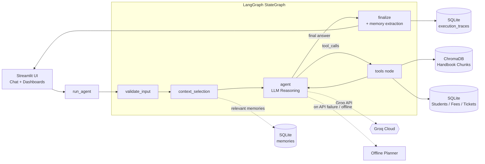

# 🎓 Intelligent Agentic Student Support System

[](https://www.python.org/)
[](https://github.com/langchain-ai/langgraph)
[](https://groq.com/)
[](https://streamlit.io/)
[](docs/assignment-1/TESTING_REPORT.md)
[-success.svg)](docs/assignment-1/EVALUATION_REPORT.md)
[](LICENSE)

**Agentic AI Engineering · PGDM (BDA / AI & DS), Batch 2025–27**  
**Author**: Raj Antala ([@antalaraj](https://github.com/antalaraj))  
**Repository**: [https://github.com/antalaraj/agentic-student-support-agent](https://github.com/antalaraj/agentic-student-support-agent)

---

## 📖 Executive Summary

The **Intelligent Agentic Student Support System** is an enterprise-grade AI system engineered to resolve realistic university student inquiries across academic regulations, financial fees, scholarship applications, and technical support ticketing.

The repository is structured to house both academic phases:
* **Assignment 1 (`assignment-1/`)**: **Fully Complete & Verified**. A production-ready, stateful single-agent architecture featuring LangGraph `StateGraph` cyclic orchestration, dynamic tool-calling across 6 custom domain tools, persistent SQLite long-term memory with heuristic privacy redaction, ChromaDB policy RAG, rate-limit resilient Groq LLM integration, and a comprehensive Streamlit dashboard.
* **Assignment 2 (`assignment-2/`)**: **Scaffolded for Development**. A forward-looking Multi-Agent Collaborative System designed with hierarchical supervisor-worker routing, human-in-the-loop approval workflows, and multi-document hybrid retrieval (active development on `feature/assignment-2`).

> ⚠️ *All student profiles, fees, scholarships, and handbook regulations in this repository are fictional demonstration assets for Meridian Institute of Management. No actual student PII is contained.*

---

## 🏛 Repository Architecture

```
agentic-student-support-agent/
├── README.md                          # Root repository documentation (this file)
├── .gitignore                         # Comprehensive Git ignore rules (secrets, DBs, caches)
│
├── assignment-1/                      # COMPLETED ASSIGNMENT 1 IMPLEMENTATION
│   ├── app.py                         # Streamlit multi-page application
│   ├── requirements.txt               # Assignment 1 dependencies
│   ├── packages.txt                   # OS-level package specifications
│   ├── pytest.ini                     # Pytest configuration
│   ├── .env.example                   # Environment configuration template
│   ├── README.md                      # Assignment 1 comprehensive manual
│   ├── ASSIGNMENT_1_AUDIT_REPORT.md   # Official compliance audit report
│   ├── TESTING_REPORT.md              # 101-test automated suite verification report
│   ├── EVALUATION_REPORT.md           # 18-case benchmark evaluation report
│   ├── config/                        # Settings, text utilities, and SQLite compatibility
│   ├── agent/                         # LangGraph state graph, nodes, routing, LLM engines
│   ├── tools/                         # 6 domain tools (profile, fee, scholarship, ticket, policy, academic)
│   ├── database/                      # SQLite models, DB connection, seed scripts, memory store
│   ├── rag/                           # ChromaDB vector store, chunking, embeddings backends
│   ├── tracing/                       # Structured JSON trace generator and metrics collector
│   ├── evaluation/                    # 18-scenario benchmark dataset, automated evaluator, results
│   ├── data/                          # Fictional student handbook, sample students JSON
│   └── tests/                         # 101 passing unit, integration, memory, and scenario tests
│
├── assignment-2/                      # PREPARED ASSIGNMENT 2 SCAFFOLDING
│   ├── README.md                      # Assignment 2 scope, milestones, and development guide
│   ├── .gitignore                     # Assignment 2 ignore rules
│   ├── .env.example                   # Environment variables template
│   ├── requirements.txt               # Multi-agent dependency specifications
│   ├── agents/                        # Supervisor orchestrator & specialist subagents (.gitkeep)
│   ├── tools/                         # Domain-specific multi-agent toolkits (.gitkeep)
│   ├── memory/                        # Multi-tenant and shared blackboard stores (.gitkeep)
│   ├── config/                        # Multi-agent policies and settings (.gitkeep)
│   ├── data/                          # Multi-document corpora (.gitkeep)
│   ├── evaluation/                    # Multi-agent collaboration benchmark (.gitkeep)
│   └── tests/                         # Multi-agent collaboration test suite (.gitkeep)
│
└── docs/                              # CENTRALIZED DOCUMENTATION HUB
    ├── README.md                      # Documentation index
    ├── architecture/                  # Architectural deep-dives & visual diagrams
    │   ├── system_architecture.md     # Detailed subsystem architecture & design principles
    │   └── diagrams.md                # Mermaid diagrams (StateGraph, ER model, memory, RAG)
    ├── assignment-1/                  # Assignment 1 deliverables & reports
    │   ├── ASSIGNMENT_1_AUDIT_REPORT.md
    │   ├── TESTING_REPORT.md
    │   ├── EVALUATION_REPORT.md
    │   └── viva_demo_guide.md         # Evaluator walkthrough & live viva demonstration script
    └── assignment-2/                  # Assignment 2 preview & roadmap
        └── ASSIGNMENT_2_ROADMAP.md    # Multi-agent collaboration architecture roadmap
```

---

## ⚡ Technology Stack

| Layer | Component | Purpose |
|---|---|---|
| **Orchestration** | **LangGraph (`>=1.0`)** | Cyclic state graph workflow with conditional routing, step ceilings, and reflection |
| **Foundation Models** | **Groq Cloud API (`langchain-groq`)** | High-throughput tool-calling inference (`openai/gpt-oss-120b`, `llama-3.3-70b-versatile`) |
| **Resilience Engine** | **Deterministic Offline Planner** | Native zero-dependency fallback guaranteeing 100% uptime during network or API outages |
| **Front-End & UI** | **Streamlit (`>=1.50`)** | Interactive 6-page dashboard: Chat, Student Records, Support Desk, Traces, Evaluation |
| **Relational Storage** | **SQLite 3** | ACID-compliant storage for students, fees, scholarships, tickets, memory, and traces |
| **Vector Database** | **ChromaDB (`>=1.0`)** | Semantic vector search across institutional policy handbooks |
| **Embeddings** | **SentenceTransformers / MiniLM** | `all-MiniLM-L6-v2` dense embeddings + deterministic lexical hashing fallback (`384-dim`) |
| **Document Parsing** | **PyMuPDF (`fitz`)** | Structural PDF and text parsing for policy handbooks |
| **Testing** | **Pytest (`>=8.0`)** | 101 automated unit, integration, memory, tool, and scenario tests |
| **Observability** | **Structured JSON Tracing** | Full per-turn audit log: execution IDs, node paths, latency, tool I/O, token counts |

---

## 🔄 Core Architecture & Agent Workflow

The core architecture operates as a directed, cyclical state graph:



### Key Architectural Pillars
1. **Dynamic Tool Calling (6 Tools)**: The model dynamically chooses whether to converse directly, inspect student records (`get_student_profile`, `check_fee_status`, `check_scholarship_status`), raise support tickets (`create_support_ticket`), or query handbook knowledge (`search_policy`, `search_academic_information`).
2. **Context Budgeting**: Keeps prompts grounded and prevents context pollution: sends at most 6 recent messages (truncated to 600 characters) and at most 3 relevant memories. Database records and RAG passages are fetched strictly on demand.
3. **Long-Term Memory with Privacy Filter**: Extracts user preferences across sessions (`call me Diya`, `interested in ML`), while deterministic regex filters automatically drop passwords, OTPs, CVVs, and API keys.
4. **Resilient Rate-Limit Handling**: Automatic exponential backoff handles Groq token replenishments (2.5s intervals). If an outage occurs, the system smoothly falls back to the deterministic offline planner.

---

## 🚀 Quick Start & Installation

### 1. Clone Repository & Setup Environment

```bash
# Clone the repository
git clone https://github.com/antalaraj/agentic-student-support-agent.git
cd agentic-student-support-agent

# Set up virtual environment
python -m venv .venv

# Activate virtual environment
# On Windows PowerShell:
.venv\Scripts\Activate.ps1
# On Linux / macOS:
source .venv/bin/activate
```

### 2. Install Assignment 1 Dependencies

```bash
cd assignment-1
pip install -r requirements.txt
```

### 3. Configure Environment Variables

```bash
# Copy example configuration
cp .env.example .env
```

Edit `assignment-1/.env` with your API credentials:
```ini
# Groq API Key (Optional: without it, the app runs in deterministic offline planner mode)
GROQ_API_KEY=your_groq_api_key_here

# Groq Model (defaults to llama-3.3-70b-versatile or openai/gpt-oss-120b)
GROQ_MODEL=openai/gpt-oss-120b
```

---

## 💻 Running & Verification Guide

All commands below should be executed from within the `assignment-1/` directory:

### 1. Launch the Streamlit Web Application
```bash
streamlit run app.py
```
* Access the interactive interface at `http://localhost:8501`.
* Select student `MIM25002 · Diya Nair` and test queries like *"What is my current fee status?"* or *"What is the late fee policy?"*.

### 2. Run the Complete Pytest Automated Test Suite
```bash
python -m pytest -v
```
* **Actual Result**: **101 passed** in ~21 seconds (100% pass rate).
* Includes tests for agent routing, 20 mandatory assignment scenarios, 6 regression verifications, memory isolation, tool guardrails, and RAG retrieval.

### 3. Run the Evaluation Benchmark (Offline Mode)
```bash
python -m evaluation.evaluator
```
* Runs the 18-case benchmark across fees, scholarships, policy scenarios, cross-session memory, and edge cases.
* **Actual Result**: **18 / 18 passed (100.0% task accuracy, 100.0% tool selection)** with zero external network dependency.

### 4. Run the Evaluation Benchmark (Live Groq LLM Mode)
```bash
python -m evaluation.evaluator --live
```
* Executes the 18 benchmark cases against the live Groq LLM.
* Tracks actual input and output tokens via Groq API metadata and measures real network latency.

---

## 📊 Evaluation & Testing Summary (Actual Results)

### Test Suite Execution
```
============================= test session starts =============================
platform win32 -- Python 3.13.14, pytest-9.0.1
rootdir: D:\agentic-student-support-agent\assignment-1
configfile: pytest.ini
testpaths: tests
collected 101 items

tests\test_agent.py .................................                    [ 32%]
tests\test_assignment_scenarios.py ..........................            [ 58%]
tests\test_evaluation.py ......                                          [ 64%]
tests\test_memory.py ........                                            [ 72%]
tests\test_rag.py .................                                      [ 89%]
tests\test_tools.py ...........                                          [100%]

======================= 101 passed, 1 warning in 21.66s =======================
```

### Benchmark Evaluation Metrics (18 Diverse Real-World Cases)
| Metric | Live Groq LLM (`openai/gpt-oss-120b`) | Deterministic Offline Planner | Verification Standard |
|---|:---:|:---:|---|
| **Total Test Cases** | **18 cases** | **18 cases** | `evaluation/dataset.json` |
| **Task Accuracy** | **100.0% (18/18)** | **100.0% (18/18)** | Grounded string & DB assertions |
| **Tool Selection Accuracy** | **100.0% (18/18)** | **100.0% (18/18)** | Dynamic tool routing verification |
| **Memory Recall Rate** | **100.0% (18/18)** | **100.0% (18/18)** | Cross-session preference recall |
| **RAG Retrieval Precision** | **100.0% (18/18)** | **100.0% (18/18)** | Handbook chunk similarity |
| **Average Turn Latency** | **3,303.6 ms** (median 1,950 ms) | **21.0 ms** (median 15 ms) | End-to-end turn duration |
| **Input Token Tracking** | **24,641 tokens** | *unavailable* (offline) | Groq API usage metadata |
| **Output Token Tracking** | **3,105 tokens** | *unavailable* (offline) | Groq API usage metadata |
| **Trace Logging Rate** | **100.0% (18/18 stored)** | **100.0% (18/18 stored)** | SQLite `execution_traces` table |

---

## 🌿 Git Branching Strategy & Workflow

This repository adheres to a structured branch and release lifecycle:

```
[main] ─────────────────────●───────────────────────► (Stable Assignment 1 & Root Docs)
                            │
                            │ Tag: assignment-1-final
                            ▼
[feature/assignment-2] ─────●────────────●──────────► (Active Assignment 2 Multi-Agent Work)
```

* **`main`**: The primary branch hosting the completed, audited Assignment 1 release, comprehensive documentation, and repository scaffolding.
* **Tag `assignment-1-final`**: Cryptographic release checkpoint marking the completed, verified Assignment 1 delivery.
* **`feature/assignment-2`**: Dedicated development branch for Assignment 2 multi-agent collaboration, HITL workflows, and extended benchmarks.

---

## 📋 Documentation & Deliverables Index

* 📄 **[Assignment 1 Audit Report](docs/assignment-1/ASSIGNMENT_1_AUDIT_REPORT.md)** — Exhaustive compliance verification across all 11 assignment specification areas.
* 📄 **[Testing Report](docs/assignment-1/TESTING_REPORT.md)** — Detailed pytest test log (101 tests), UI subagent audit, and root cause analysis of fixed bugs.
* 📄 **[Evaluation Report](docs/assignment-1/EVALUATION_REPORT.md)** — In-depth breakdown of the 18-case benchmark with latency, token usage, and retrieval evidence.
* 📄 **[Viva Voce & Live Demo Guide](docs/assignment-1/viva_demo_guide.md)** — Complete step-by-step evaluator script and anticipated technical defense Q&A.
* 📄 **[System Architecture](docs/architecture/system_architecture.md)** — Full subsystem specification (StateGraph, Context Selection, Memory, Tools, RAG, Tracing).
* 📄 **[Architectural Diagrams](docs/architecture/diagrams.md)** — Visual Mermaid diagrams of all workflows and relational schemas.
* 📄 **[Assignment 2 Roadmap](docs/assignment-2/ASSIGNMENT_2_ROADMAP.md)** — Technical roadmap and multi-agent architecture plan for Assignment 2.

---

## 🛡 Security & Privacy Safeguards

* **Zero Secret Leakage**: API keys and environment variables are strictly excluded from version control via `.gitignore`.
* **Credential Scrubbing**: Input text is scanned via regex before entering memory; passwords, OTPs, PINs, card numbers, and API keys are permanently discarded.
* **Student Identity Isolation**: Tool execution enforces the authenticated session student ID over any spoofed tool arguments.
* **Ephemeral Local Databases**: Databases and ChromaDB vector stores are generated locally and ignored from Git commits.

---

## 📜 License & Acknowledgments

This project is submitted as part of the **Agentic AI Engineering** curriculum for the PGDM (BDA / AI & DS) Batch 2025–27.  
Developed under the **MIT License**.
