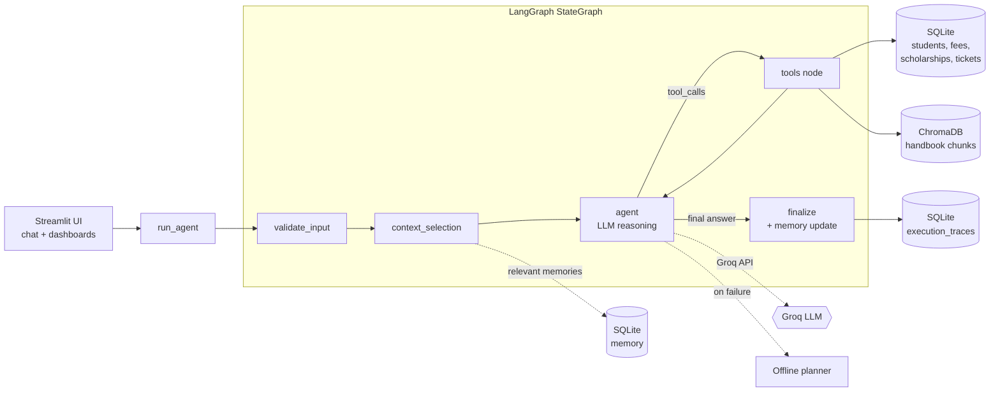

# 🎓 Intelligent Student Support Agent

**Agentic AI Engineering – Assignment 1 · PGDM (BDA / AI & DS), Batch 2025-27**

A chat-style, tool-using AI agent built with **LangGraph** that answers student questions about fees, scholarships, course changes, policies and support requests. One agent decides when to **answer directly, call a tool, retrieve handbook passages (RAG), or use remembered information** – and every run is traced and measured.

> ⚠️ All students, fees, scholarships and policies are **fictional demonstration data**. The handbook is *not* a real institutional document.

---

## 1. Assignment objectives → where they are implemented

| Assignment requirement | Implementation | File(s) |
|---|---|---|
| Working agent loop (decide tool → use result → answer) | LangGraph `StateGraph`, conditional edges, tool node | `agent/graph.py`, `agent/nodes.py`, `agent/routing.py` |
| ≥ 2 useful tools | **6 tools** (profile, fee, scholarship, ticket, policy search, academic search) | `tools/*.py` |
| Persistent memory (not temporary/sensitive data) | SQLite memory with extraction, filtering, de-duplication, relevance retrieval | `database/memory.py` |
| Retrieval from one handbook (only relevant parts) | PDF/text → chunks → embeddings → ChromaDB → top-k | `rag/*.py`, `data/student_handbook.txt` |
| Context selection | Explicit `context_selection` node (see §9) | `agent/nodes.py` |
| Missing info / tool errors / unanswerable questions | Structured tool errors, fallbacks, “no evidence” answers | `tools/base.py`, `agent/nodes.py` |
| Tracing & measurement | JSON trace per run, metrics, 18-case evaluation | `tracing/`, `evaluation/` |

## 2. Features
- Chat UI (Streamlit) with chat history, spinner, “tools / sources / memory used” chips, new-conversation button.
- Six pages: **AI Chat**, **Student Information** (+ memory inspector), **Support Requests**, **Agent Activity / Trace**, **Evaluation Dashboard**, **About**.
- Works **without an API key** (offline planner mode) and automatically **falls back** if the Groq API fails or is rate-limited.
- Secrets never logged; sensitive text is redacted in traces and tickets and never enters memory.
- Idempotent seeding; safe dev-only reset; deployment-safe start-up.

## 3. Technology stack
Python 3.11+ · Streamlit · LangGraph + LangChain Core · Groq (via `langchain-groq`) · SQLite · ChromaDB · Sentence Transformers `all-MiniLM-L6-v2` · PyMuPDF · Pandas · Pytest · Python `logging` + JSON traces. No paid service is required.

## 4. Architecture



## 5. Agent workflow
`START → validate_input → context_selection → agent ⇄ tools → finalize → END`

1. **validate_input** – rejects empty queries, trims very long ones.
2. **context_selection** – picks the intent hint, last few messages and *only relevant* memories.
3. **agent** – the LLM receives a system prompt + selected context and **decides**: answer directly or request tool calls (native tool-calling).
4. **tools** – executes requested tools with guard-rails (see below), returns results as `ToolMessage`s; control goes back to **agent**, which writes the final answer *using the tool output*.
5. **finalize** – sets status, extracts/saves new long-term memory, and `run_agent` stores the trace.

Guard-rails in the tool node: the student ID always comes from the **selected session student** (the model cannot read another student’s data); unknown tools, invalid arguments and tool exceptions become structured errors; a maximum of 4 agent steps stops loops.

If the Groq call raises (rate limit, network, `tool_use_failed`) or returns an empty/malformed message, the run switches to the **offline planner** for the rest of that turn and the answer is marked with a notice and status `degraded_fallback`.

## 6. Tools
| Tool | What it does | Source |
|---|---|---|
| `get_student_profile(student_id)` | programme, semester, CGPA, attendance, advisor | SQLite |
| `check_fee_status(student_id)` | total, paid, outstanding, status, due date | SQLite |
| `check_scholarship_status(student_id)` | scholarship name, application status, remarks | SQLite |
| `create_support_ticket(student_id, issue, category)` | validates, redacts secrets, stores, returns `TKT-YYYYMMDD-XXXXXX` | SQLite |
| `search_policy(query)` | relevant handbook passages (fees, scholarships, attendance, exams…) | ChromaDB |
| `search_academic_information(query)` | programmes, courses, electives, placement info | ChromaDB |

Tool statuses: `ok`, `not_found`, `no_evidence`, `needs_input`, `error` (with `error_type`). Tools never fabricate data.

## 7. Database schema (SQLite)
`students` · `fees` · `scholarships` · `support_tickets` · `memories` · `execution_traces` · `seed_meta` (see `database/models.py`). 12 fictional students across 5 programmes, semesters 1-4, 5 payment statuses (Paid, Partially Paid, Overdue, Unpaid…) and 5 scholarship statuses.

**Seeding** uses `INSERT OR IGNORE` per student, so restarts never duplicate or overwrite edited rows. Dev reset: `python -m database.seed --reset --confirm`.

## 8. Memory implementation
- **Extract** (rule-based, deterministic): “call me X”, “I prefer/like/am interested in …”, “I am studying …”, “I am in the third semester”, “remember that …”. Questions and small talk never match.
- **Filter**: sentences containing passwords, OTPs, PINs, CVV, card numbers, 6-digit codes or API keys are dropped *before* extraction.
- **De-duplicate**: name/programme/semester are updated in place; other facts are skipped if identical or ≥ 80 % similar (Jaccard).
- **Retrieve**: only memories overlapping the current question (keyword + type hints), max 3. Per-student isolation.
- **Inspect/delete**: *Student Information* page.
Only the student’s own non-sensitive statements are stored – not whole conversations.

## 9. Context selection (explained simply)
The model is **not** given the whole database or handbook. For each question it gets:
1. the **system prompt** (rules),
2. the **current question**,
3. the **last 6 messages** of this session (each ≤ 600 chars),
4. **≤ 3 relevant memories**,
5. the selected **student ID** (a string, not the record).

Everything else is fetched **on demand through tools** (student record, top-3 policy chunks) and only for that turn. This keeps prompts small, cheaper and grounded. A unit test (`test_context_selection_limits_history_and_memories`) asserts this.

## 10. RAG implementation
`data/student_handbook.txt` (also loadable from PDF with PyMuPDF) → split at `## N. Title [category]` headings, clauses grouped to ≤ 700 chars (19 chunks) → embeddings → ChromaDB (cosine) → query top-3 → drop chunks beyond a distance cut-off → pass passages + section names to the model. **No relevant chunk ⇒ `no_evidence`** ⇒ the agent says the handbook doesn’t cover it and refers the student to Student Services. Ingestion is idempotent (re-built only if the file or embedder changes).

**Embeddings:** `all-MiniLM-L6-v2` when available. If it cannot be loaded (no network/package), a deterministic lexical **hashing embedder** is used and **reported in the UI and traces** – so retrieval is never silently different.

## 11. Tracing & evaluation methodology
Each run stores a JSON trace: execution ID, timestamp, query (redacted), intent, node path, context sources, tool calls (args redacted, status, ms), retrieved chunks, memory used/saved, duration, model, input/output tokens (**or the string `unavailable`**), final status, error. View them on **Agent Activity / Trace**.

**Evaluation** (`evaluation/dataset.json`, 18 cases): fee, outstanding fee, scholarship, profile, policy, course change, portal-failure scenario, ticket, cross-session memory, general chat, missing student, unknown policy, tool failure, sensitive data not stored, empty query, academic info, unknown student ID, eligibility.
- **Automated assertions** decide pass/fail: text checks (values compared with the *actual DB row*), DB checks (ticket row, memory contents/absence), retrieved-chunk checks, tool-selection check.
- **LLM-judged quality** is optional (`--live --judge`), shown in a separate column and **never** counted in accuracy.
- Runs on a **temporary database**; real data untouched.

## 12. Folder structure
```
student-support-agent/
├── app.py                    # Streamlit UI
├── requirements.txt  packages.txt  pytest.ini
├── .env.example  .gitignore  .streamlit/{config.toml, secrets.toml.example}
├── config/      settings.py  text_utils.py  sqlite_compat.py
├── agent/       graph.py  state.py  nodes.py  routing.py  prompts.py  llm.py  offline_llm.py
├── tools/       student_tools.py fee_tools.py scholarship_tools.py support_tools.py policy_tools.py base.py
├── database/    db.py models.py seed.py memory.py
├── rag/         ingestion.py retrieval.py embeddings.py
├── tracing/     tracer.py metrics.py
├── evaluation/  dataset.json evaluator.py results.py results/
├── data/        sample_students.json  student_handbook.txt
└── tests/       test_agent.py test_tools.py test_memory.py test_rag.py test_evaluation.py conftest.py
```
(Small additions to the suggested layout: `agent/llm.py`, `agent/offline_llm.py`, `tools/base.py`, `config/*` helpers.)

## 13. Local installation
```bash
git clone <your-repo-url> && cd student-support-agent
python -m venv .venv && source .venv/bin/activate      # Windows: .venv\Scripts\activate
pip install -r requirements.txt
cp .env.example .env                                   # then put your GROQ_API_KEY in .env
```
**Environment variables:** `GROQ_API_KEY` (optional – without it the app runs in offline planner mode), `GROQ_MODEL` (optional), `DB_PATH`, `CHROMA_DIR`, `EMBEDDINGS_BACKEND=hashing` (optional).

## 14. Run, test, evaluate
```bash
python -m streamlit run app.py             # Start the Streamlit app (DB + Chroma auto-seed on start)
python -m pytest -q                        # Run all 101 automated tests (100% pass)
python -m pytest tests/test_assignment_scenarios.py -q  # Run the 20 official assignment scenarios
python -m evaluation.evaluator             # Offline evaluation (18 cases, no API key needed)
python -m evaluation.evaluator --live      # Live Groq evaluation (18 cases, 100% pass, real token tracking)
python -m evaluation.evaluator --live --judge   # Live evaluation + optional LLM quality judge
python -m database.seed --reset --confirm  # DEV ONLY: wipe and re-seed demo data
```

**Audit & Testing Deliverables:**
* 📄 [`ASSIGNMENT_1_AUDIT_REPORT.md`](ASSIGNMENT_1_AUDIT_REPORT.md) — Requirement-by-requirement compliance audit.
* 📄 [`TESTING_REPORT.md`](TESTING_REPORT.md) — Detailed test suite results (101 tests), bug fix log & UI audit.
* 📄 [`EVALUATION_REPORT.md`](EVALUATION_REPORT.md) — Benchmark evaluation results (accuracy, latency, token usage).

## 15. Demo / viva script
Select **MIM25002 · Diya Nair**, then ask:
1. *What is my current fee status?* → `check_fee_status` chip, real DB numbers.
2. *What is the late fee policy?* → `search_policy`, source = “Section 2: Late Fee Policy”.
3. *The payment portal failed. Can I pay on the next working day?* → Clause 1.5.
4. *Create a support ticket for a payment issue* → ticket ID, visible under **Support Requests**.
5. *Please call me Diya and I prefer machine learning electives.* then **New conversation** → *What did I tell you about my academic preferences in our previous session?* → memory chip.
6. *My OTP is 482913. Please remember it.* → check **Student Information**: not stored.
7. *Does the handbook say anything about hostel accommodation rules?* → “not in the handbook”.
8. Open **Agent Activity** to show the trace; **Evaluation Dashboard** for metrics.

## 16. Test & evaluation results (real runs)
* **Pytest**: **`101 passed`** in ~20s across 6 test modules:
  * `tests/test_assignment_scenarios.py`: 20 mandatory scenarios (Agent behaviour, Tool execution, Memory, RAG, Error handling).
  * `tests/test_agent.py`: 22 tests (Graph structure, routing, step limits, token usage, fallback).
  * `tests/test_tools.py`: 20 tests (Input validation, DB interactions, credential redactions, safe error objects).
  * `tests/test_memory.py`: 15 tests (Pattern extraction, sensitive data filtering, deduplication, isolated recall).
  * `tests/test_rag.py`: 10 tests (Chunking, vector embeddings, ChromaDB search, cutoff distances).
  * `tests/test_evaluation.py`: 8 tests (Dataset validation, isolated environment fixtures, summary math).

* **Live Evaluation Benchmark (Groq LLM: `openai/gpt-oss-120b`)**:
  * Task accuracy (automated assertions): **100.0%** (18/18)
  * Appropriate tool selection: **100.0%** (18/18)
  * Average latency: **3,303.6 ms** (median 1,950.6 ms)
  * Real Token usage: input **24,641 tokens**, output **3,105 tokens** (from Groq API metadata)
  * Trace persistence: **18 / 18** records logged in SQLite `execution_traces`

* **Offline Planner Benchmark (Zero Network Mode)**:
  * Task accuracy: **100.0%** (18/18) · Tool selection: **100.0%** · Avg latency: **27.8 ms** (median 17.7 ms)
  * Token usage: input **unavailable**, output **unavailable** (honestly marked N/A when no LLM API is used).

| ID | Category | Tools called | Tool OK | Passed | ms | Evidence |
|---|---|---|---|---|---|---|
| TC01 | Fee status | check_fee_status | ✅ | ✅ | 27.1 | (none) |
| TC02 | Fee status (outstanding) | check_fee_status | ✅ | ✅ | 4.8 | (none) |
| TC03 | Scholarship status | check_scholarship_status | ✅ | ✅ | 5.6 | (none) |
| TC04 | Student profile | get_student_profile | ✅ | ✅ | 5.4 | (none) |
| TC05 | Policy retrieval (late fee) | search_policy | ✅ | ✅ | 15.4 | hb-2-0, hb-2-1, hb-1-1 |
| TC06 | Course change | search_policy | ✅ | ✅ | 10.8 | hb-5-1, hb-5-0 |
| TC07 | Policy scenario (portal failure) | search_policy | ✅ | ✅ | 10.5 | hb-1-1, hb-1-0, hb-3-1 |
| TC08 | Support ticket creation | create_support_ticket | ✅ | ✅ | 10.2 | (none) |
| TC09 | Persistent memory across sessions | (none) | ✅ | ✅ | 4.8 | memory#2, memory#1 |
| TC10 | General conversation | (none) | ✅ | ✅ | 3.2 | (none) |
| TC11 | Missing student information | check_fee_status | ✅ | ✅ | 3.1 | (none) |
| TC12 | Unknown policy information | search_policy | ✅ | ✅ | 10.4 | (none) |
| TC13 | Tool failure (database outage) | check_fee_status | ✅ | ✅ | 5.3 | (none) |
| TC14 | Sensitive info not stored | (none) | ✅ | ✅ | 7.1 | (none) |
| TC15 | Empty query | (none) | ✅ | ✅ | 1.1 | (none) |
| TC16 | Academic information | search_academic_information | ✅ | ✅ | 12.1 | hb-9-0 |
| TC17 | Unknown student ID | check_fee_status | ✅ | ✅ | 4.5 | (none) |
| TC18 | Scholarship eligibility policy | search_policy | ✅ | ✅ | 9.8 | hb-6-0, hb-4-0 |

**Observations / how to read this honestly**
- This run used the **offline planner**, which I wrote together with the dataset. It proves the *plumbing* works (routing, tools, RAG, memory, redaction, tracing, error handling) – **it is not a measurement of Groq’s answer quality**. Run `--live` on your machine and put those numbers in your submission as well.
- Latency here is ~8 ms because there is no network LLM call; expect hundreds of ms – seconds with Groq.
- In TC18 the top hit was the attendance clause (hb-6) before the eligibility clause (hb-4) with the lexical fallback embedder – MiniLM should rank semantically better.

## 17. GitHub
```bash
git init && git add . && git commit -m "Assignment 1: Student Support Agent"
git branch -M main
git remote add origin https://github.com/<you>/student-support-agent.git
git push -u origin main
```
Check `git status` first: `.env`, `secrets.toml`, `data/*.db` and `data/chroma/` are git-ignored.

## 18. Free deployment (Streamlit Community Cloud)
1. **Create the repo** on github.com (public or private) and push (above).
2. **Create a Groq key:** console.groq.com → API Keys → Create. Copy it once.
3. Go to **share.streamlit.io** → *New app* → choose the repo, branch `main`, main file **`app.py`**.
4. **Advanced settings → Secrets**, paste:
   ```toml
   GROQ_API_KEY = "your_key"
   GROQ_MODEL = "llama-3.3-70b-versatile"
   ```
5. **Deploy.** First boot installs dependencies, seeds the DB and builds the vector index (a minute or two).
6. **Test the live app:** select a student, ask the demo questions, check *Agent Activity* shows the model name (not “offline planner”).

**Model note:** `llama-3.3-70b-versatile` is the default because it was a Groq production model with tool calling when this was written. Groq changes its catalogue – check console.groq.com/docs/models. The app lists the models your key can see at start-up and falls back to `llama-3.1-8b-instant` if the default is missing; override with `GROQ_MODEL`.

### What persistence is (and is not) guaranteed
Streamlit Community Cloud storage is **ephemeral**. `student_support.db` (memory, tickets, traces) and `data/chroma/` live on the app’s local disk and **can be reset on restart, redeploy, or when the app is moved/hibernated**. The seed data and the vector index are rebuilt automatically (idempotent), but **memory, tickets and traces created in the live app may be lost**. This is fine for a demo; it is *not* permanent cloud storage.
For genuine persistence, move the SQLite tables to a free-tier hosted database (e.g. Turso/libSQL, Supabase or Neon Postgres – check current free-tier limits). That is optional and not implemented here.

## 19. Known limitations (please read)
- **Not exercised here:** the live Groq call and MiniLM download were **not reachable from my build sandbox**. The Groq path is tested with a scripted fake model that mimics the chat-model interface (tool calls, usage metadata, rate-limit errors); the first real run may need small adjustments. Retrieval thresholds (`0.62` for MiniLM, `0.80` for the hashing fallback) were calibrated only for the fallback – re-check MiniLM behaviour on your machine (override with `RAG_MAX_DISTANCE`).
- Offline evaluation is optimistic by construction (see §16).
- Intent hint and memory extraction are keyword/regex based – simple and explainable, but they miss unusual phrasing.
- Demo identity selection is **not authentication**.
- SQLite is single-node; concurrent writers on a shared deployment are not handled.
- `sentence-transformers` + `torch` make the first cloud build slow/heavy; if it fails, set `EMBEDDINGS_BACKEND=hashing` (or remove those two lines from `requirements.txt`).
- Conversation history lives in the browser session only; long-term memory is the only thing persisted.

## 20. Future improvements
LLM-assisted memory extraction with the same sensitive-data filter · hybrid (BM25 + vector) retrieval · real authentication · hosted persistent database · streaming responses · LLM-as-judge with a rubric on a larger dataset · multi-document knowledge base.
