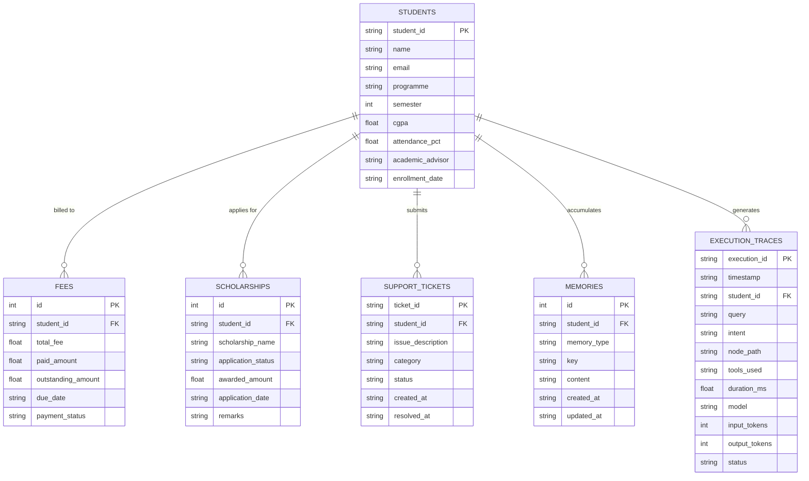
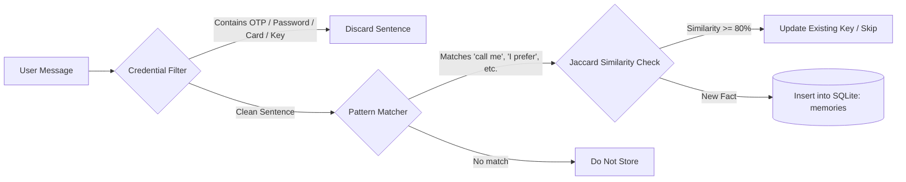
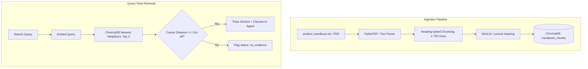
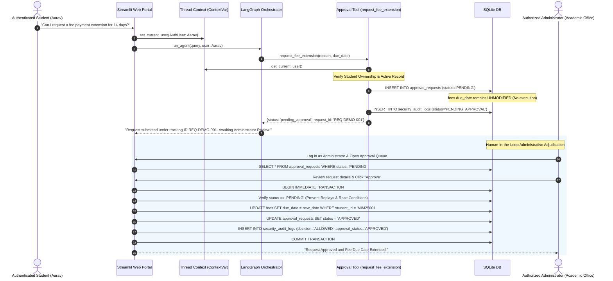
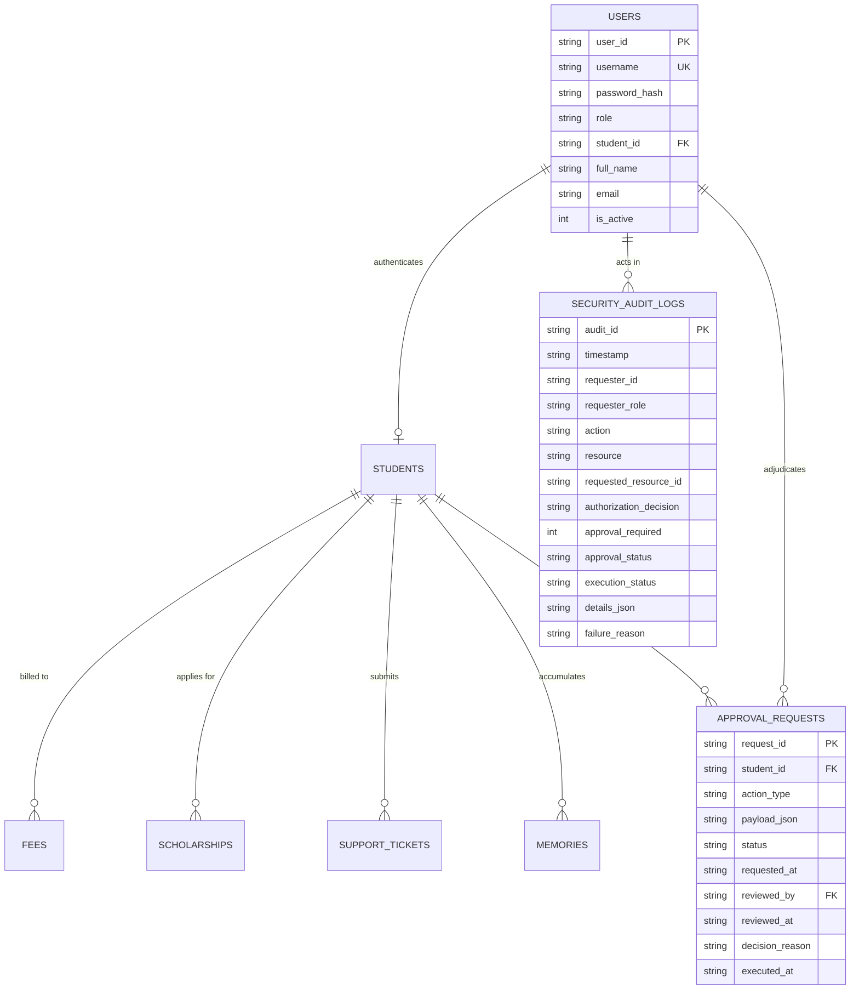

# 📊 Architectural Diagrams: Intelligent Student Support Agent

This document provides visual architectural representations using standard Mermaid syntax.

---

## 1. LangGraph StateGraph Execution Flow

---

## 2. Relational Database Entity-Relationship Model (SQLite)

---

## 3. Persistent Memory Lifecycle

---

## 4. Policy RAG Pipeline

---

## 5. Assignment 2: Security & Sensitive Action Human-in-the-Loop (HITL) Workflow

---

## 6. Extended Relational Entity-Relationship Model (Assignment 2)

