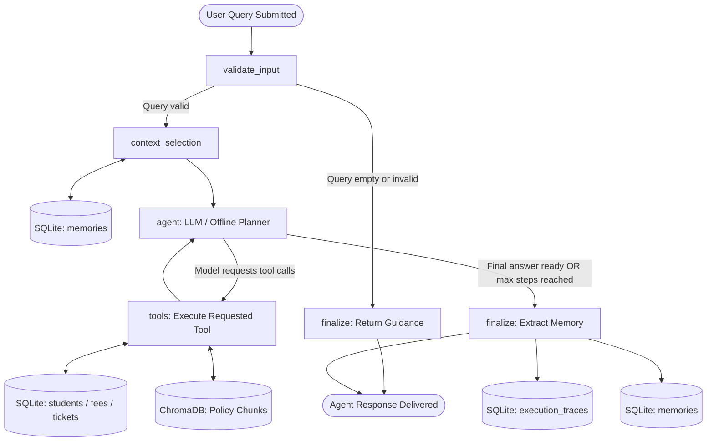
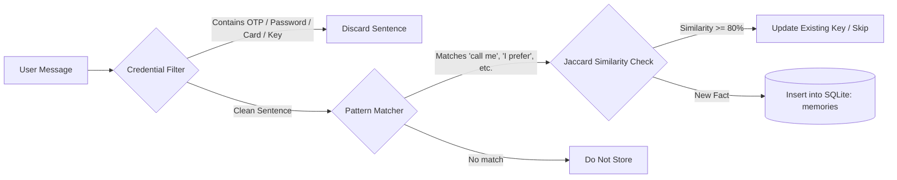
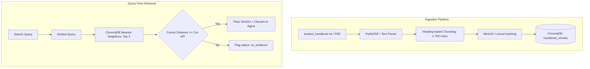

# 📊 Architectural Diagrams: Intelligent Student Support Agent

This document provides visual architectural representations using standard Mermaid syntax.

---

## 1. LangGraph StateGraph Execution Flow

---

## 2. Relational Database Entity-Relationship Model (SQLite)

```mermaid
erDiagram
    STUDENTS ||--o{ FEES : "billed to"
    STUDENTS ||--o{ SCHOLARSHIPS : "applies for"
    STUDENTS ||--o{ SUPPORT_TICKETS : "submits"
    STUDENTS ||--o{ MEMORIES : "accumulates"
    STUDENTS ||--o{ EXECUTION_TRACES : "generates"

    STUDENTS {
        string student_id PK
        string name
        string email
        string programme
        int semester
        float cgpa
        float attendance_pct
        string academic_advisor
        string enrollment_date
    }

    FEES {
        int id PK
        string student_id FK
        float total_fee
        float paid_amount
        float outstanding_amount
        string due_date
        string payment_status
    }

    SCHOLARSHIPS {
        int id PK
        string student_id FK
        string scholarship_name
        string application_status
        float awarded_amount
        string application_date
        string remarks
    }

    SUPPORT_TICKETS {
        string ticket_id PK
        string student_id FK
        string issue_description
        string category
        string status
        string created_at
        string resolved_at
    }

    MEMORIES {
        int id PK
        string student_id FK
        string memory_type
        string key
        string content
        string created_at
        string updated_at
    }

    EXECUTION_TRACES {
        string execution_id PK
        string timestamp
        string student_id FK
        string query
        string intent
        string node_path
        string tools_used
        float duration_ms
        string model
        int input_tokens
        int output_tokens
        string status
    }
```

---

## 3. Persistent Memory Lifecycle

---

## 4. Policy RAG Pipeline

